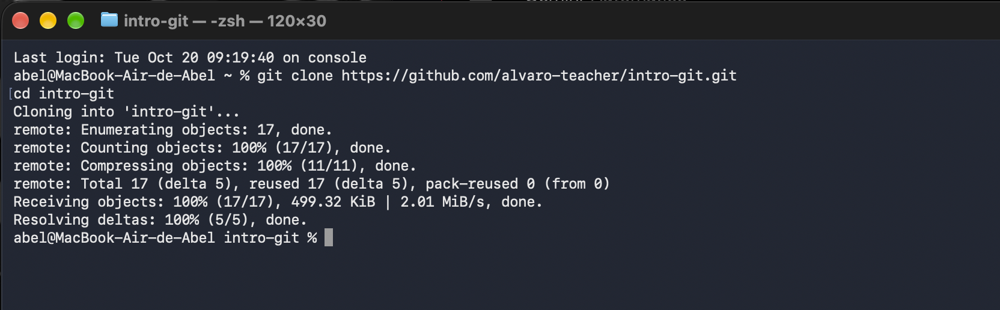
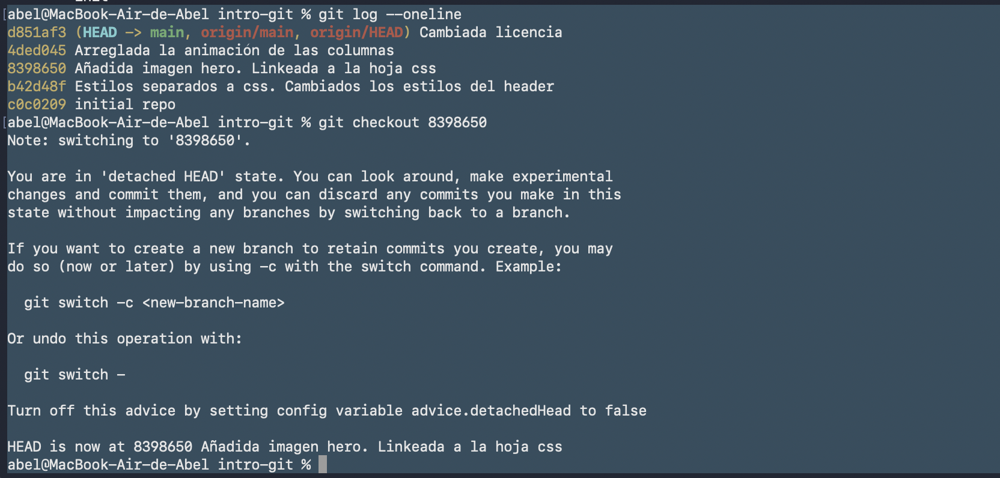
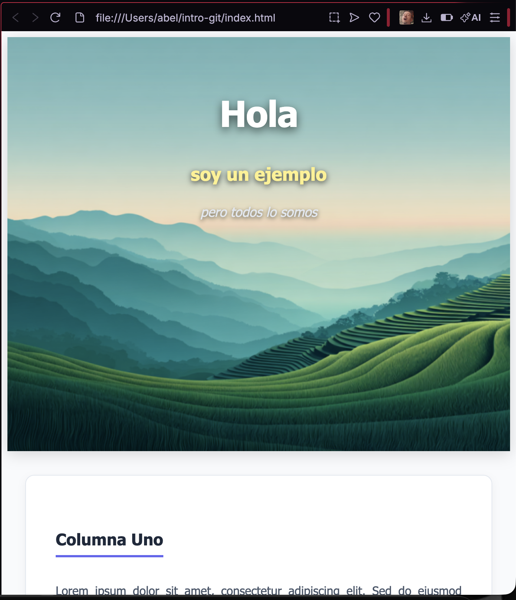
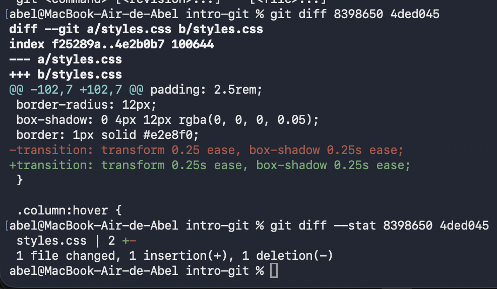
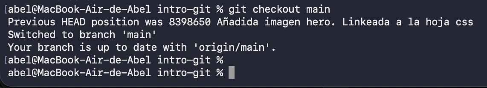
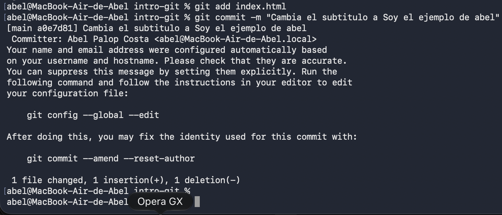
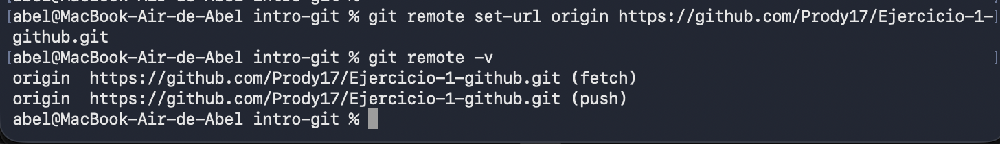

# Práctica de Git - Introducción (`intro-git`)

Este repositorio contiene la solución a la práctica de control de versiones con Git, explorando el historial, la inspección de cambios y la modificación del proyecto.

## Capturas del proceso

### 1. Clonado del repositorio e historial

### 2. Estado anterior de la web

### 3. Inspección del commit `4ded045` (`git diff`)

### 4. Volver al último commit

### 5. Realizar el commit del cambio

### 6. Creación del repositorio y cambio de URL remota

## Cambios realizados
- Se modificó el subtítulo del archivo `index.html` por: *"Este es el ejemplo de Abel"*.
- Se reconfiguró el repositorio remoto para apuntar a mi cuenta personal de GitHub.